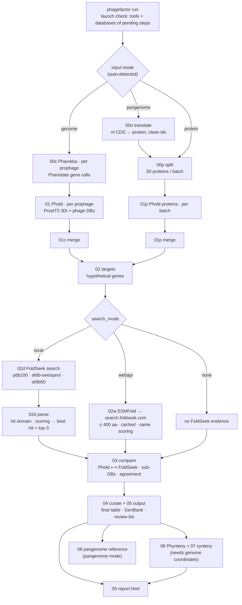
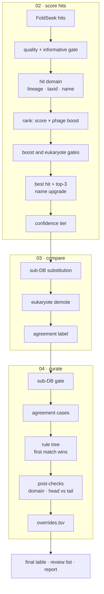

# Architecture

Two diagrams (Mermaid, rendered by GitHub; PNG copies in [`diagrams/`](diagrams/)). Prose version of the scoring and curation
logic: [`curation_gates.md`](curation_gates.md); where each word-list lives:
[`code_lists.md`](code_lists.md).

## 1. Pipeline

Three input modes converge on one shared spine. Step numbers are the script
prefixes in `scripts/`.

Local and web-API search produce identically shaped `best_hit.csv` / `top3.csv`, so
everything downstream is the same whichever ran. The web API takes structures only,
hence the ESMFold step and the 400 aa limit.

## 2. Scoring and curation

How a set of FoldSeek hits becomes one call per gene.

Two points the diagram is meant to make obvious:

1. **The informativeness gate removes most hits**, before any scoring happens.
2. **Trusted calls are never re-annotated.** Only Pharokka-hypothetical genes enter
   curation; a sequence-homology call is passed through untouched.
